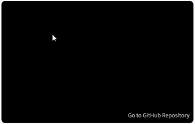

# Overview

An interactive Delaunay diagram in the browser, built with [Three.js](https://threejs.org/). Drop in points and watch the triangles knit themselves together in real time — the classic triangulation, alive in a web page.

This project is the Three.js version of [m5core2_delaunay](https://github.com/cubic9com/m5core2_delaunay).

\[日本語\]

[Three.js](https://threejs.org/)で作られた、ブラウザ上で動作するインタラクティブなドロネー図。点を配置すると、三角形がリアルタイムで次々と組み合わさっていく様子を観察できます。古典的な三角形分割の手法が、ウェブページ上で生き生きと展開されます。

このプロジェクトは [m5core2_delaunay](https://github.com/cubic9com/m5core2_delaunay) のThree.js版です。

# Video



# How to Use

1. Open [this page](https://cubic9com.github.io/threejs_delaunay/) in a browser.

\[日本語\]

1. [このページ](https://cubic9com.github.io/threejs_delaunay/) をブラウザで開きます。

# Installation for developers

1. Clone the repository:
    ```sh
    git clone https://github.com/cubic9com/threejs_delaunay.git
    cd threejs_delaunay
    ```

2. Open the project in Visual Studio Code:
    ```sh
    code .
    ```

\[日本語\]

1. リポジトリをクローンします:
    ```sh
    git clone https://github.com/cubic9com/threejs_delaunay.git
    cd threejs_delaunay
    ```

2. Visual Studio Code でプロジェクトを開きます:
    ```sh
    code .
    ```

# License

Copyright (C) 2025, cubic9com All rights reserved.

This project is licensed under the MIT license.

See the `LICENSE` file for details.

